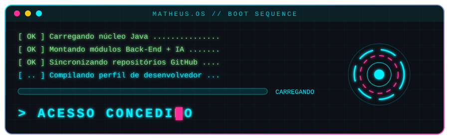

<!-- ═══════════════════════════════════════════════════════════
     MATHEUS.OS · GitHub Profile README
     Repositório: eumatheusvieira/eumatheusvieira
     Paleta: #0D1117 (fundo) · #00F0FF (ciano) · #FF2E97 (magenta)
     ═══════════════════════════════════════════════════════════ -->

<div align="center">




<a href="https://git.io/typing-svg">
  
</a>

<br/>


</div>

<br/>

---

## `> ./sobre_mim.sh`

<div align="center">

<table>
<tr>
<td width="62%" valign="top">

```yaml
usuario:     Matheus Vieira Rocha
funcao:      Desenvolvedor Java / Back-End
formacao:    Engenharia de Software - UCB (2026-2029)
atuacao:     Aprendiz @ BRB Serviços (RH)
localizacao: Brasília - DF, Brasil
idiomas:     [Português: nativo, Inglês: C1]
foco:        APIs REST · Java · IA aplicada · Mobile
status:      Em evolução constante ⚡
```

</td>
<td width="38%" valign="top">

**🧠 Resumo do sistema**

Estudante de Engenharia de Software apaixonado por construir soluções reais: de **automações para planilhas** a **aplicações web** e **sistemas IoT**.

Aprendo na prática, com bootcamps, projetos autorais e muito Git.

</td>
</tr>
</table>

</div>

<br/>

<div align="center">


</div>

---

## `> ./tech_stack --list`

<div align="center">

### 💻 Linguagens


### 🌐 Front-End


### ⚙️ Back-End & Frameworks


### 🗄️ Bancos de Dados


</div>

---

## `> ./ferramentas --status`

<div align="center">


<br/><br/>

| 🛠️ Ferramenta | 🎯 Uso |
| :--- | :--- |
| **IntelliJ IDEA** | Ambiente principal para Java e Spring |
| **Git & GitHub** | Versionamento e desenvolvimento colaborativo |
| **Docker** | Containers e ambientes reproduzíveis |
| **WSL / Arch Linux** | Terminal, automação e dia a dia de desenvolvimento |
| **MySQL** | Modelagem e consultas relacionais |

</div>

---

## `> ./objetivos --current`

```bash
matheus@os:~$ cat objetivos_atuais.log

[██████████░░░░░░░░░░]  50%  ☕ Bootcamp Santander 2026 - AI Java Back-End (DIO)
[████████░░░░░░░░░░░░]  40%  🎓 Engenharia de Software - UCB (2026 → 2029)
[██████░░░░░░░░░░░░░░]  30%  🍎 Preparação para o Apple Developer Academy (iOS)
[████░░░░░░░░░░░░░░░░]  20%  🚀 Evoluir em Spring Boot + APIs REST
[███░░░░░░░░░░░░░░░░░]  15%  🔐 Aprofundar em Cibersegurança

matheus@os:~$ git commit -m "evoluindo um dia de cada vez"
[main 7f3a9c2] evoluindo um dia de cada vez
 1 objetivo concluído por dia, sempre.

matheus@os:~$ _
```

> 💡 Ajuste as porcentagens conforme o seu progresso real.

---

## `> ./github_stats --analyze`

<div align="center">


<br/>
</div>

---

## `> ./snake --eat contributions`

<div align="center">

<picture>
  <source media="(prefers-color-scheme: dark)" srcset="https://raw.githubusercontent.com/eumatheusvieira/eumatheusvieira/output/github-snake-dark.svg"/>
  <source media="(prefers-color-scheme: light)" srcset="https://raw.githubusercontent.com/eumatheusvieira/eumatheusvieira/output/github-snake.svg"/>
  
</picture>

</div>

---

## `> ./contato --connect`

<div align="center">

<a href="https://www.linkedin.com/in/eumatheusvieira">
  
</a>
<a href="https://github.com/eumatheusvieira">
  
</a>
<a href="mailto:dev.matheusvrocha@gmail.com">
  
</a>

</div>

<br/>

<div align="center">


<sub>© 2026 Matheus Vieira</sub>

</div>
